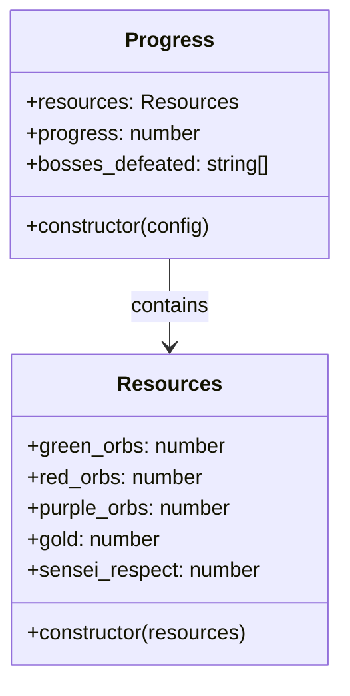
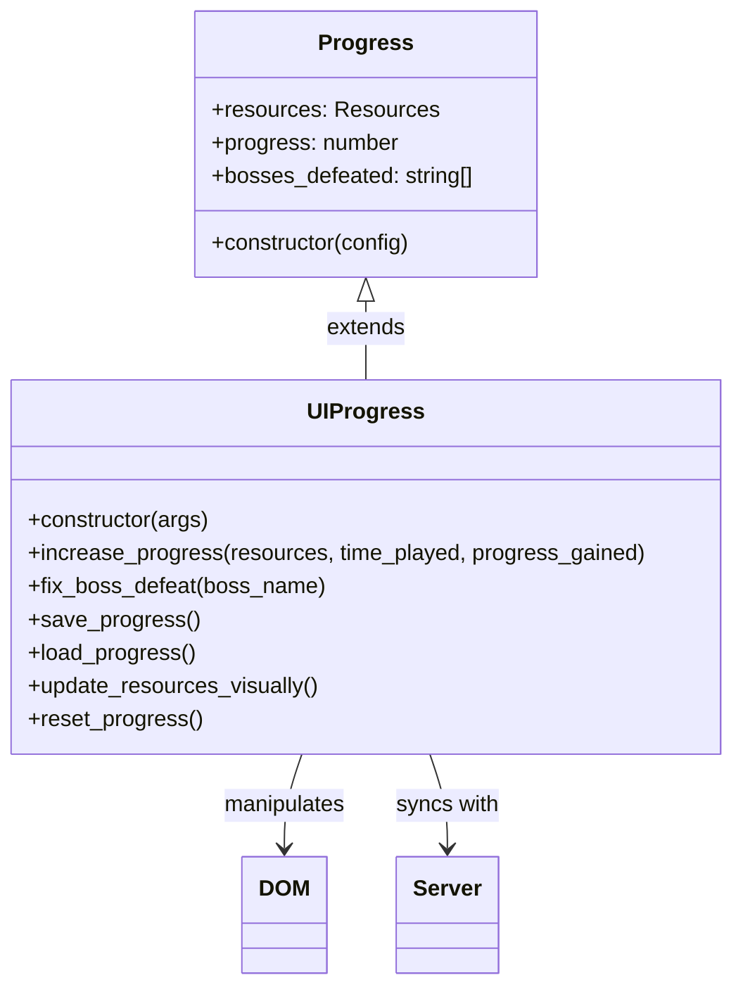
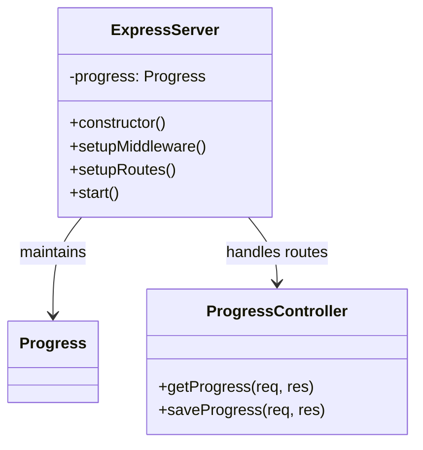
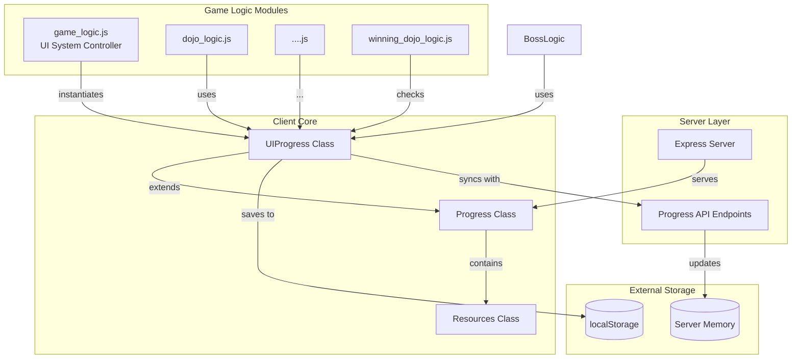

# Shadow Fight game simulator

## Intro
This is the project taken seriously as part of the course MUAM 24-25. It is a lab 3(or 4) according to the program.
**Idea:** The simulation of shadow fight 2 in THA web.
Check if variable areLocationsQuality in game_logic.js on top of the script is set true to change the quality videos to the good(not necessary at all).
Pls wait until repo is cloned, video take a lot of space)

## Presentation instructions
How to gain the progress in the game to show the working application:
- grind progress on the tournament location - it almost immediately gives +1 progress pts
- progress = 5 - For fighting the Lynx Boss bodyguard
- progress = 10 - For fighting the Lynx Boss
- have no idea how to unbound the strong sync of localStorage with the server

## Key Ideas
I'm a little bit proud of this project as here I tried to implement OOP concept.
- 2 main classes representing the data of this small app
- tried to isolate the UI logic by moving the necessary UI logic to the class

# Resources & Progress

## Client-Side State Management (Inheritance Pattern)

## Server Architecture

---

## Component Interaction Diagram

